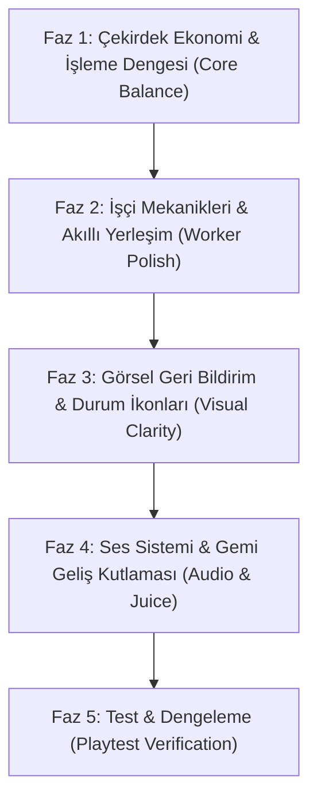

# 📋 Mining Tycoon - Vertical Slice & Demo Polish Master Plan

Bu doküman, Mining Tycoon'un prototip aşamasından arkadaş testine (playtest) hazır, cilalı 15-20 dakikalık bir **Vertical Slice Demo** sürümüne dönüştürülmesi için hazırlanan ana yol haritasıdır.

Tüm sistemler modüler, SOLID prensiplerine uygun ve projenin mevcut mimarisini (Singleton, ScriptableObject, Event-driven UI) bozmayacak şekilde tasarlanmıştır.

---

## 🎯 Hedef ve Problem Tanımları

1. **AutoProcessor Değersizliği & Dengesizlik:**
   - İşçiler makinelerden daha hızlı işleme yapıyor.
   - Tüm madenler (Kömür, Altın, Elmas) aynı sürede işleniyor.
   - AutoProcessor yavaş kalıyor, oyuncu makine almak yerine işçi basıyor.
2. **Görsel Karmaşa ve Geri Bildirim Eksikliği:**
   - Harita büyüdükçe kim nerede durmuş, hangi konteyner dolmuş, hangi fırına kömür gelmiyor anlaşılmıyor.
3. **İşçi Kimliği & İlk Yerleşim Hantallığı:**
   - Tüm işçilerin adı aynı ("Worker").
   - Çalışma alanına (MiningArea / ProcessArea) konulan işçi otomatik çalışmaya başlamıyor; oyuncunun tıklayıp tekrar yönlendirmesi gerekiyor.
4. **İşçi Seviye & Yükseltme Dengesi:**
   - İşçi yükseltme maliyetleri lineer ve dengesiz; oyunun ilerleyen dakikalarında sonsuz işçi spam'ini önleyecek katlanarak artan (üstel) bir maliyet eğrisi yok.
5. **Ses & "Juice" (Tatmin Hissi) Eksikliği:**
   - Gemi geldiğinde, para kazanıldığında veya alışveriş yapıldığında ses ve görsel kutlama (floating text) yok.

---

## 🗺️ Faz ve Uygulama Sıralaması (Roadmap)

---

## 📦 FAZ 1: Çekirdek Ekonomi & İşleme Dengesi

### 1.1 Maden Bazlı İşleme Süresi (`ItemData.processTime`)
* **Problem:** Kömür de 2 saniyede işleniyor, en değerli Elmas da 2 saniyede işleniyor.
* **Tasarım:**
  - `ItemData.cs` içine her madenin kendi işlenme süresini belirten `float processTime` alanı eklenir:
    - **Kömür (Coal):** 1.5 saniye (Hızlı, giriş seviyesi)
    - **Altın (Gold):** 3.5 saniye (Orta seviye)
    - **Elmas (Diamond):** 6.0 saniye (Yavaş, değerli)
  - `ProcessArea.cs` ve `WorkerInteraction.cs`: `currentInteractable.OperationTime` yerine `item.processTime` değerini referans alır.

### 1.2 AutoProcessor vs İşçi Dengelemesi
* **Problem:** AutoProcessor çok hantal ve gereksiz.
* **Tasarım:**
  - **AutoProcessor:** Üretim süresi formülü -> `productionTime = item.processTime * 0.4f` (İşçiden en az %60 daha hızlı!). Ayrıca birden fazla girdiyi depolayıp durmaksızın seri üretime devam eder.
  - **İşçi (Worker):** İşçinin maden kazma hızı ile işleme hızı ayrıştırılır veya işleme süresi `item.processTime / worker.WorkSpeed` olarak hesaplanır.
  - **Sonuç:** Oyuncu yüksek madenlere geçtikçe (Altın, Elmas) işçilerin elle işlemesi çok yavaşlayacak, AutoProcessor bir zorunluluk ve büyük bir otomasyon yükseltmesi haline gelecek.

---

## 👷 FAZ 2: İşçi Mekanikleri, İsimlendirme & Akıllı Yerleşim

### 2.1 İsim Üretici Havuzu (Worker Name Generator)
* **Problem:** Hiyerarşide ve UI panellerinde tüm işçiler "Worker" adında.
* **Tasarım:**
  - ScriptableObject veya statik bir isim havuzu oluşturulur:
    *(Örn: "Gimli", "Bob", "Kazma Ali", "Demirci Hasan", "Rusty", "Veli", "Digger Dave")*
  - İşçi prefab'ı sahnede doğduğunda (`Awake` veya `WorkerManager.HandlePlaced`), rastgele bir isim ve benzersiz bir numara alır: `"Gimli #1"`, `"Bob #2"`.
  - Worker UI panelinde işçinin başlığında bu isim görünür.

### 2.2 Akıllı İlk Yerleşim (Auto-Detect Work Area on Spawn)
* **Problem:** İşçi bir maden veya fırın alanına konduğunda `Idle` modda mal gibi bekliyor.
* **Tasarım:**
  - `WorkerManager.HandlePlaced` içinde veya `Worker.Start()` içinde `Physics2D.OverlapPoint(worldPos, workableLayer)` kontrolü yapılır.
  - Eğer işçi doğrudan bir `MiningArea` veya `ProcessArea` içine bırakılmışsa:
    1. `CurrentState = WorkerState.Working;`
    2. `CurrentWorkType = interactable.WorkType;`
    3. Grid hücresi rezerve edilir (`OccupiedCells.Add`).
    4. İşçi paneli açılmadan veya ekstra tıklamaya gerek kalmadan hemen kazmaya/işlemeye başlar!

### 2.3 Üstel Seviye (Level Up) & Maliyet Mekaniği
* **Tasarım (Senior Game Designer Formülü):**
  - **Neye göre seviye atlayacak?**
    Oyun bir Tycoon oyunu olduğu için en iyi model **"Altın Harcayarak Terfi Ettirme (Paid Promotion)"** modelidir. Bu, oyundaki fazla parayı emen mükemmel bir para çıkışıdır (Gold Sink).
  - **Maliyet Formülü (Üstel Katlanma):**
    $$\text{Cost} = \text{BaseCost} \times (1.85)^{\text{Level} - 1}$$
    - Level 1 -> 2: **400$**
    - Level 2 -> 3: **740$**
    - Level 3 -> 4: **1,370$**
    - Level 4 -> 5: **2,530$**
    - Level 5 -> 6: **4,680$**
    - Level 6 -> 7: **8,660$**
  - **Seviye Başına Kazanımlar:**
    - `WorkSpeed`: +%20 artış
    - `CarryCapacity`: +10 kapasite artışı
    - `MovementSpeed`: +%10 hız artışı
  - Seviye atladıkça işçinin başındaki yıldız sayısı veya UI'daki rütbesi artar.

---

## ⚠️ FAZ 3: Görsel Geri Bildirim & Durum İkonları (Alert Indicators)

### 3.1 Dünya Üzeri Yüzen Durum İndikatörü (`StatusIndicator`)
* **Problem:** 5 maden, 10 işçi, 3 fabrika olunca kim durmuş, neresi dolmuş belli olmuyor.
* **Tasarım:**
  - İşçilerin ve Binaların kafasının üzerine küçük bir Sprite veya World Canvas objesi konur (`StatusIndicator.cs`).
  - `Worker.OnStatusChanged` ve `Building.OnStorageChanged` event'lerini dinler.
  - Duruma göre animasyonlu/sabit mini ikon gösterir:
    - 🔴 **Kapasite Dolu (Full):** Kırmızı çanta veya dolu sandık simgesi (İşçi veya Makine çıkışı boşaltılmalı).
    - 🟡 **Girdi Yok (No Input):** Boş tabak / eksik hammadde simgesi (İşçiye hammadde taşınmalı).
    - 💤 **Boşta (Idle / No Ore):** Zzz veya uyarı işareti.
    - 🟢 **Normal Çalışma (Working / Processing):** İkon gizlenir (ekran temiz kalır).

---

## 🎵 FAZ 4: Ses Sistemi & Gemi Geliş Kutlaması (Audio & Juice)

### 4.1 Basit ve Temiz `AudioManager` (Singleton)
* **Bileşenler:**
  - `BGM Source` (Loop çalan huzurlu madenci/tycoon müziği).
  - `SFX Source` (OneShot ses efektleri havuzu).
* **Ses Efektleri Listesi:**
  1. `ShipHorn_SFX`: Gemi limana yanaştığında çalan kalın "DÜT DÜT" vapur sireni.
  2. `Coin_SFX`: Satış yapıldığında veya para kazanıldığında çalan şıngırtı sesi.
  3. `ShopBuy_SFX`: Mağazadan işçi veya bina alındığında tok bir onay sesi.
  4. `Pickaxe_SFX`: Maden kazıldığında periyodik vuruş tıkırtısı (hafif).

### 4.2 Gemi Satış Efekti & Yüzen Para Yazısı (Floating Money Text)
* `ShipmentManager.OnShipmentCompleted` event'ine abone olunur.
* Gemi geldiğinde:
  1. `ShipHorn_SFX` çalar.
  2. Eğer kazanç > 0 ise:
     - `Coin_SFX` çalar.
     - Limanda / geminin üzerinde yukarı doğru süzülüp kaybolan yeşil `+1,450$` yazısı belirir.
     - UI'daki para barı hafifçe büyüyüp küçülür (Punch scale efekti).

---

## 🎮 FAZ 5: Test & Dengeleme (Playtest Checklist)

Arkadaşlarına göndermeden önce 15 dakikalık oynanış testi kriterleri:
- [ ] 0-3 dk: Oyuncu kömür kazar, ilk işçisini alır. İşçi hemen madene başlar.
- [ ] 3-7 dk: Kargo gemisi ilk sevkiyatını yapar ("Düt Düt"), oyuncu kazandığı parayla AutoProcessor kurar.
- [ ] 7-12 dk: Altın ve Elmas madenlerine geçilir. İşçilerin elması işlemesi uzun sürerken AutoProcessor'ün seri eritmesi oyuncuyu tatmin eder.
- [ ] 12-18 dk: Taşıyıcı işçiler ve seviye atlatılmış ustalar ile tam otomasyon kurulur. Hiçbir worker kilitlenmez veya duvara takılmaz.

---

## 📝 Çalışma Kuralı ve Kodlama Rehberi
1. Bu plan doğrultusunda adımları **parça parça** ele alacağız.
2. `AgentInstructions.md` gereğince:
   - Önce mimari ve fonksiyon imzaları (`// TODO:` açıklamalarıyla) verilecek.
   - Kodları **sen kendin yazacaksın**, takıldığın yerde senior olarak mantığı ve ipuçlarını açıklayacağım.
   - Her adım bittiğinde test edip bir sonraki adıma geçeceğiz.
